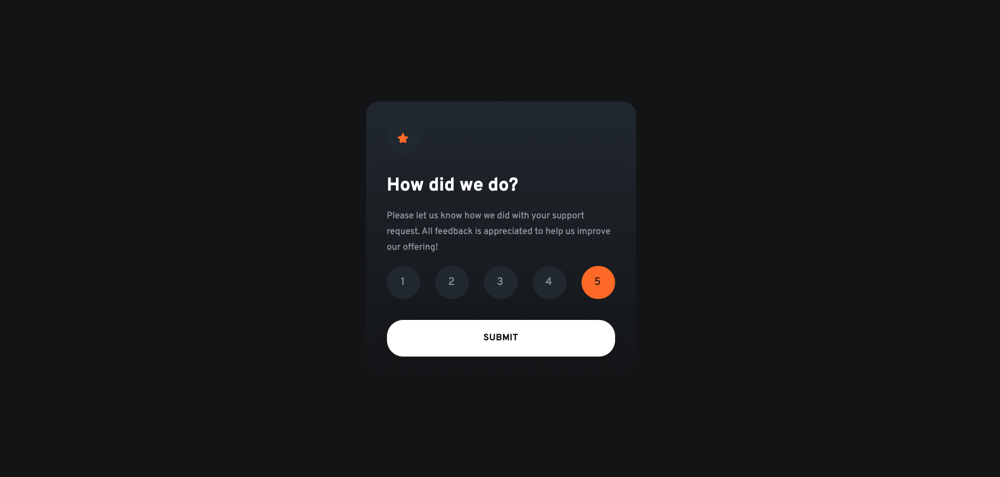

# Frontend Mentor - Interactive Rating Component Solution

This is my solution to the [Interactive Rating Component challenge on Frontend Mentor](https://www.frontendmentor.io/challenges/interactive-rating-component-koxpeBUmI).

This project helped me practice semantic HTML, responsive CSS, JavaScript DOM manipulation, and accessibility.

## Table of Contents

- [Overview](#overview)
  - [The Challenge](#the-challenge)
  - [Screenshot](#screenshot)
  - [Links](#links)
- [My Process](#my-process)
  - [Built With](#built-with)
  - [What I Learned](#what-i-learned)
  - [Continued Development](#continued-development)
  - [AI Collaboration](#ai-collaboration)
- [Author](#author)

## Overview

### The Challenge

Users should be able to:

- View an optimal layout on mobile and desktop devices.
- See hover and focus states for interactive elements.
- Select a rating from 1 to 5.
- Submit their selected rating.
- See a Thank You message displaying their selected rating.
- Navigate and interact with the component using a keyboard.

### Screenshot



### Links

-[Solution URL]()
-[Live Site URL:]()

## My Process

### Built With

- Semantic HTML5
- CSS custom properties
- Flexbox
- Mobile-first workflow
- CSS media queries
- Vanilla JavaScript
- DOM manipulation
- Accessible HTML forms

### What I Learned

During this project, I improved my understanding of HTML, CSS, JavaScript, and accessibility.

**1. Semantic HTML and accessible forms**

I learned how to use `fieldset` and `legend` to group related radio buttons and make forms more accessible.

```html
<fieldset class="rating">
  <legend>Choose a rating from 1 to 5</legend>

  <label>
    <input type="radio" name="rating" value="1">
    <span>1</span>
  </label>
</fieldset>
```

**2. CSS pseudo-classes**

I practiced styling interactive elements using `:hover`, `:checked`, and `:focus-visible`.

```css
.rating input:checked + span {
  background-color: var(--color-orange);
  color: var(--color-grey-950);
}

.rating input:focus-visible + span {
  outline: 3px solid var(--color-white);
  outline-offset: 3px;
}
```

**3. Responsive design**

I used a mobile-first approach and media queries to adapt the component to larger screens.

```css
@media screen and (min-width: 768px) {
  .rating-card,
  .thank-you-card {
    width: min(412px, 100%);
  }
}
```

**4. JavaScript DOM manipulation**

I learned how to handle form submissions, retrieve the selected radio button, and update page content dynamically.

```js
const selectedRating = ratingForm.querySelector(
  'input[name="rating"]:checked'
);

if (selectedRating) {
  selectedRatingText.textContent = selectedRating.value;

  ratingForm.hidden = true;
  thankYouCard.hidden = false;

  thankYouTitle.focus();
}
```

**5. Accessibility and keyboard navigation**

I learned why keyboard focus is important and how to use `tabindex="-1"` and `.focus()` to improve the experience when switching between the rating form and the Thank You message.

### Continued Development

In future projects, I want to continue improving my skills in:

- JavaScript and DOM manipulation.
- Responsive layouts and CSS organization.
- Form validation and accessible error messages.
- Keyboard navigation and accessibility.
- Writing clean and maintainable code.

### AI Collaboration

I used ChatGPT as a learning mentor throughout this project.

Instead of generating the entire solution, I worked through the challenge step by step, writing the HTML, CSS, and JavaScript myself.

ChatGPT helped me understand new concepts, review my code, identify improvements, and practice problem-solving through small exercises.

This approach helped me better understand how the component works rather than simply copying a finished solution.

## Author

- Frontend Mentor - [@doomyhub229](https://www.frontendmentor.io/profile/doomyhub229)
- GitHub - [@doomyhub229](https://github.com/doomyhub229)